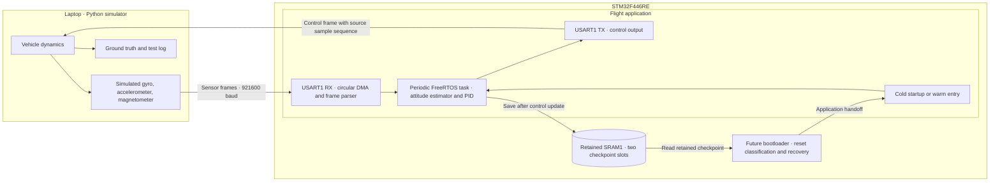

# UAV Warm-Boot Recovery

Embedded C firmware for an **STM32F446RE** flight computer. The project measures how quickly the MCU can resume valid control after a watchdog reset and whether its saved attitude is still usable. A separate Python simulator supplies sensor readings and ground truth for closed-loop hardware-in-the-loop (HIL) tests.

## Planned system overview



The simulator advances in real time, including during MCU resets. In the planned closed loop, a periodic flight task will consume the latest fresh sensor sample, update the attitude estimate, and run PID. Ground truth stays on the laptop for evaluation. USART2 provides the debug console.

## Implementation and verification status

| Component | Current status |
| --- | --- |
| NUCLEO-F446RE bring-up | Verified the USART2 boot banner and FreeRTOS LD2 heartbeat on the board. |
| USART1 DMA transport | Verified the startup banner and short echo in the loopback build. At 921600 baud the board echoed 513-byte and 16,384-byte bursts byte for byte, with no USART2 loopback errors. |
| HIL sensor receive path | The default firmware reads binary frames and publishes a complete validated sample through `HilLink_GetLatestSensor()`. Host tests cover decoded values, split frames, simulated ring wraps, and resynchronization. The live 200 Hz stream and reset resynchronization still need board verification. |
| Attitude estimator | Gyro propagation and stationary accel/mag initialization passed all nine host tests and linked in an STM32 Debug build. Firmware task integration and on-target runtime measurements are pending. |
| Flight control and recovery | The control return frame, PID, checkpointing, watchdog fault injection, and bootloader remain planned. |

## HIL sensor protocol v1

The simulator sends one binary sensor frame per sample over **USART1 at 921600 baud, 8N1, with no flow control**. Start at a configurable **200 Hz** (one sample every 5 ms). All three vectors in each frame share the same sample time. Keep streaming through an MCU reset, with sample sequence and time continuing from the same simulation run.

| Decoded byte offset | Field | Encoding |
| ---: | --- | --- |
| 0 | Protocol version | `uint8`, value `1` |
| 1 | Message type | `uint8`, value `1` for a sensor sample |
| 2–3 | Sensor payload length | `uint16`, value `36` for the nine sensor floats |
| 4–7 | Sample sequence | `uint32`, starts at zero and increments per sample |
| 8–15 | Sample timestamp | `uint64`, microseconds since simulation start |
| 16–27 | Gyro X, Y, Z | Three IEEE 754 `float32` values in rad/s |
| 28–39 | Accel X, Y, Z | Three IEEE 754 `float32` values in m/s² of specific force |
| 40–51 | Mag X, Y, Z | Three IEEE 754 `float32` values in µT |
| 52–55 | CRC-32 | `uint32`, Python `zlib.crc32` over decoded bytes 0–51 |

Use **little-endian** encoding throughout. In Python, the header and sensor payload match `struct.pack("<BBHIQ9f", ...)`. The 36-byte payload length counts only the nine sensor floats. The sequence and timestamp are metadata. Append the CRC as a little-endian `uint32`, COBS-encode the resulting 56 bytes, and append a `0x00` delimiter. The receiver uses the delimiter to regain alignment after an incomplete frame. It checks the version, type, length, and CRC before publishing a sample.

All vectors use **body axes (X forward, Y right, Z down)**. For a level, stationary vehicle pointing north, an example decoded sample is:

```text
sample_seq     = 42
sample_time_us = 210000
gyro_rad_s     = [0.0, 0.0, 0.0]
accel_m_s2     = [0.0, 0.0, -9.80665]
mag_uT         = [22.0, 0.0, 44.0]
```

The 58-byte wire frame for this sample, including the final delimiter, is:

```text
04 01 01 24 02 2a 01 01 04 50 34 03 01 01 01 01
01 01 01 01 01 01 01 01 01 01 01 01 01 01 01 01
01 01 01 01 05 0a e8 1c c1 01 03 b0 41 01 01 01
01 01 07 30 42 9f d6 62 fc 00
```

The stationary accelerometer reads negative Z because it measures upward specific force. The simulator's reference magnetic field is `[22, 0, 44] µT` in North-East-Down (NED), rotated into the body frame. Use timestamp differences for propagation. The live simulator currently timestamps sequence zero at 5000 µs, while its offline reference log starts at zero.

The proposed control return frame carries the source sensor sequence, estimated quaternion, boot path, and a flag indicating whether the MCU is producing control output. Motor command fields, order, units, and fault and boot-path IDs are open. The proposed reset behavior is to hold the last valid motor command consistently across recovery tests. The command applied before the first valid output still needs agreement.

## Attitude estimator

[`attitude_estimator.c`](flight-app/Core/Src/attitude_estimator.c) is standalone C. Its [public API](flight-app/Core/Inc/attitude_estimator.h) uses scalar-first `[w, x, y, z]` quaternions that rotate body vectors into NED.

1. `AttitudeEstimator_QuaternionFromAccelMag()` estimates an initial attitude from one stationary sample. Negative specific force gives down, and the horizontal magnetic field gives north. The caller establishes stationarity. Zero, nonfinite, or nearly collinear vectors fail without changing the output quaternion.
2. `AttitudeEstimator_Init()` takes that quaternion or another caller-supplied starting attitude, a fixed gyro bias in rad/s, and a maximum sample gap in microseconds.
3. `AttitudeEstimator_Update()` uses the first sample to store the timestamp and corrected rate. For each subsequent sample, it forms a delta quaternion from the previous sample's bias-corrected rate and the elapsed time, right-multiplies the current attitude, and normalizes the result. Duplicate and backward timestamps leave the state unchanged. A gap above the configured limit preserves the last attitude and requires reinitialization.

The next integration step is to give a FreeRTOS task ownership of the estimator and have it consume fresh HIL samples. Bias calibration and accel/mag correction during motion are future work. The live simulator starts in flight. Its separate reference log begins with a stationary segment for offline bias calibration, then covers yaw, roll, and horizontal acceleration.

## Planned bootloader and warm recovery

The flight task will write and commit a checkpoint late in each control iteration, alternating between two slots in a fixed `.noinit` region of SRAM1. Each checkpoint holds the attitude quaternion, gyro bias, arming state, GPS lock validity, sequence ID, sentinel, and CRC. DMA buffers sit outside the retained region.

| Reset path | Planned behavior |
| --- | --- |
| Cold start | Read and clear the RCC reset flags. Use normal application initialization on power-on or external reset. |
| Watchdog warm start | Distinguish IWDG and WWDG resets and evaluate them separately. Select the newest intact checkpoint. Bring up USART1/DMA, obtain a fresh sample, and use a conservative age bound and sensor observations to accept, correct, or reject the saved attitude. Check gyro bias separately. |
| Warm fallback | If the saved attitude is unusable, attempt reinitialization from usable accelerometer and magnetometer measurements. Reuse saved gyro bias only if it passes its own checks. |

The warm handoff will set the application vector table and stack pointer, then jump to a warm entry point that starts fresh FreeRTOS tasks. The build order is **flight application and HIL**, then **application-level warm recovery**, then **bootloader integration and final timing measurements**.

Two CRCs protect separate data:

| CRC | Writer | Reader |
| --- | --- | --- |
| Sensor-frame CRC | The simulator computes it over the serialized header and readings. | The STM32 parser recalculates it after receiving the packet. |
| Checkpoint CRC | The flight application computes it over the retained state when saving. | The recovery code recalculates it after reset to detect torn writes or corruption. |

A valid checkpoint CRC verifies integrity. A stale attitude can still pass it, so recovery also considers the checkpoint age and fresh sensor data.

### Evaluation

Compare cold boot, blind warm restore, sensor-based reinitialization, and the proposed recovery rule. Inject IWDG starvation, WWDG deadline overruns, and software resets during checkpoint writes. Use DWT cycle counts and GPIO scope markers to measure **watchdog detection latency** separately from **reset release to first valid control output**. Use simulator ground truth to measure attitude error and false-accept and false-reject rates.

Brownout, main-power loss, preserving live FreeRTOS task stacks, and bootloader MPU setup are out of scope.

## Build and bench test

### Host tests

From the repository root, use Python 3 and a C compiler with the math library to run the parser and estimator tests.

```sh
python3 tests/hil_sensor_test.py -v

cc -std=c11 -Wall -Wextra -Werror -pedantic -O2 \
  -Iflight-app/Core/Inc \
  tests/attitude_estimator_test.c \
  flight-app/Core/Src/attitude_estimator.c \
  -lm -o /tmp/warmboot-attitude-test
/tmp/warmboot-attitude-test
```

The parser suite runs four tests using Python-generated frames. The estimator prints `9 attitude estimator tests passed` after checking quaternion propagation, bias subtraction, timestamp handling, stationary heading and tilt, and rejection of unusable sensor vectors.

### Nucleo bench

1. In STM32CubeIDE, use **File → Import → Existing Projects into Workspace** and select [`flight-app/`](flight-app/). Build **Debug** with CubeIDE's bundled GNU Tools for STM32. Open [`flight-app.ioc`](flight-app/flight-app.ioc) to inspect or regenerate the CubeMX configuration.
2. Connect the Nucleo over ST-LINK USB and run or debug to flash it. Resume execution if the debugger stops at `main()`.
3. Connect a **3.3 V logic** USB-to-UART adapter. Wire **TXD → D2 (PA10)**, **RXD → D8 (PA9)**, and **GND → GND**. Leave VCC disconnected with the Nucleo powered through ST-LINK.

On Linux, find the ports with `ls -l /dev/serial/by-id/`. Open each in a separate terminal, substituting the device names on your machine:

```sh
picocom -b 115200 /dev/ttyACM0  # ST-LINK debug console
picocom -b 921600 /dev/ttyUSB0  # External adapter
```

Open the USART2 port before pressing **RESET**. Expect `flight-app boot` on ST-LINK and one full LD2 blink cycle per second. The default firmware receives binary HIL frames on USART1. The transport publishes the latest complete sample through `HilLink_GetLatestSensor` for a task to read and check for freshness.

Define `HIL_LINK_LOOPBACK=1` in the CubeIDE C compiler's preprocessor settings and rebuild for the echo bench test. This build prints `USART1 hello test` after reset and echoes bytes on USART1. In the adapter terminal, type `hello` with local echo off and expect it back once. Exit both Picocom sessions with **Ctrl+A**, then **Ctrl+X**.

For the DMA wrap test, run the following command with the loopback build already running. Substitute the port paths from `/dev/serial/by-id/` as needed.

```sh
python3 tools/check_usart1_echo.py /dev/ttyUSB0 /dev/ttyACM0
```

The script sends a 513-byte burst followed by a 16,384-byte stream, compares both echoes byte for byte, and checks USART2 for loopback errors. [`hil_link.c`](flight-app/Core/Src/hil_link.c) uses a 512-byte circular RX DMA buffer and a separate staging buffer. The transport reports a detected UART/DMA error or receive overrun on USART2 and stops until reset.
